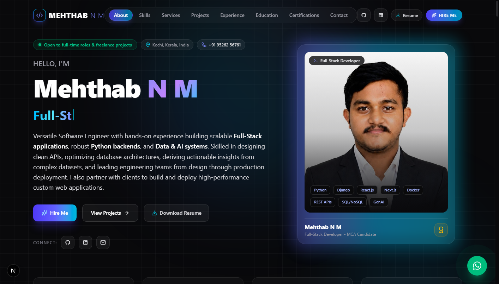
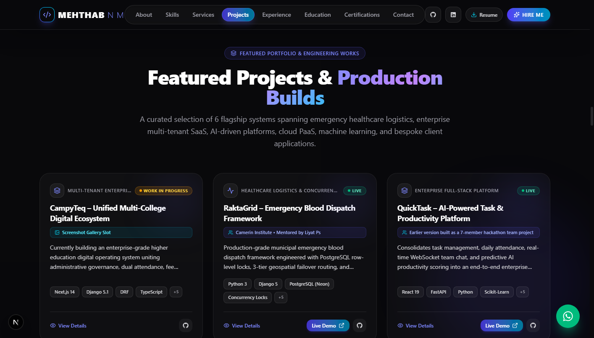
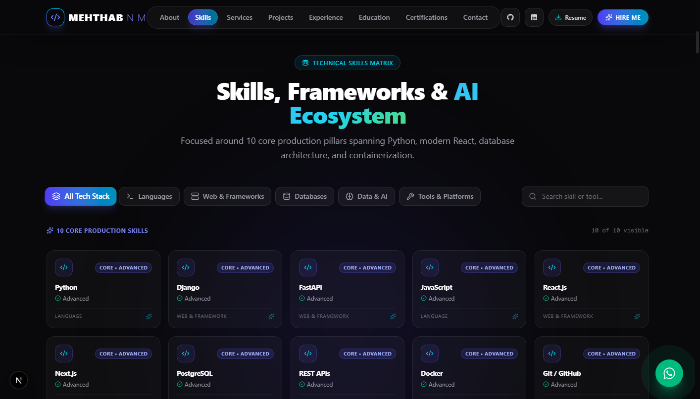
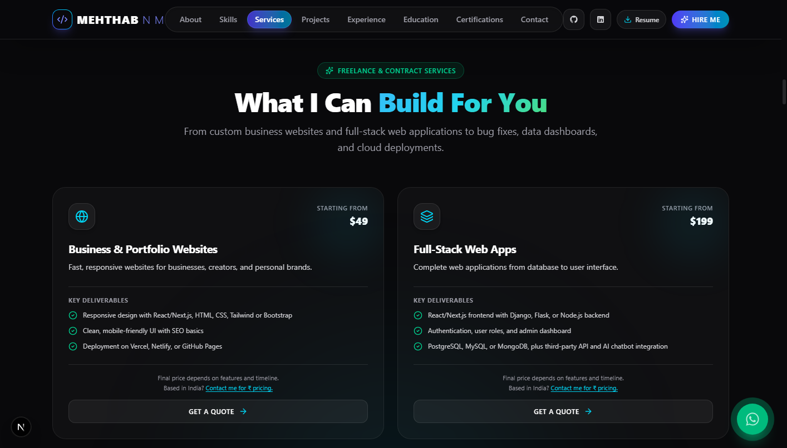
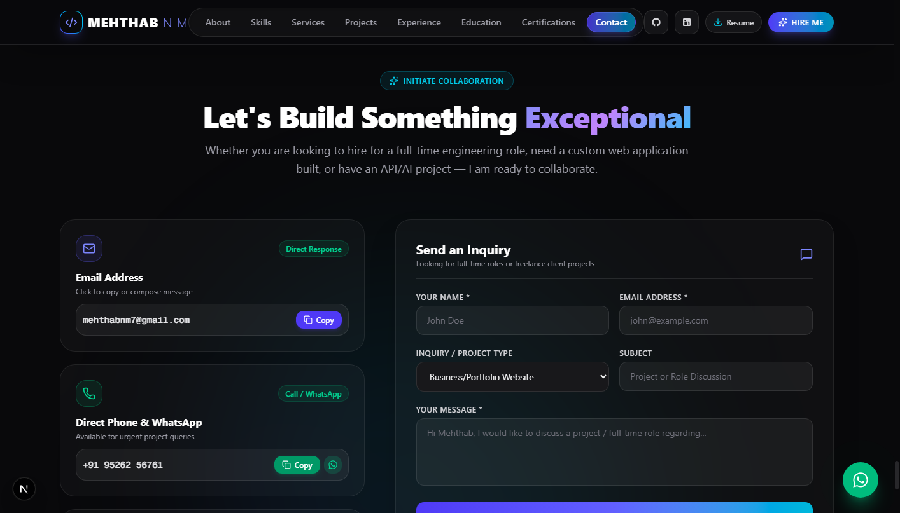

# 🌐 Mehthab N M: Developer Portfolio

> My personal portfolio showcasing flagship projects, engineering skills, professional experience, and technical leadership.

🔗 **Live Deployment:** [mehthab-n-m.github.io/My_portfolio](https://mehthab-n-m.github.io/My_portfolio/)

---

## 📑 Table of Contents

- [📸 Portfolio Preview](#-portfolio-preview)
- [⭐ Key Features](#-key-features)
- [✨ Sections](#-sections)
- [🧱 Tech Stack](#-tech-stack)
- [📂 Project Structure](#-project-structure)
- [⚙️ Run Locally](#️-run-locally)
- [🚀 Build](#-build)
- [📬 Contact](#-contact)

---

## 📸 Portfolio Preview

<p align="center">
  
</p>

### 🖼️ Sections Gallery

| 🚀 Featured Projects & Production Builds | ⚡ Technical Skills & AI Matrix |
|:---:|:---:|
|  |  |

| 💼 Professional Experience & Education | 📬 Interactive Contact Section |
|:---:|:---:|
|  |  |

---

## ⭐ Key Features

- 📱 **Fully Responsive:** Seamless layout experience tailored across mobile, tablet, and ultra-wide displays.
- 🎞️ **Micro-Animations & Transitions:** Fluid kinetic feedback and scroll-triggered reveals with Framer Motion.
- 🔍 **Filterable Skills Matrix:** Categorized tech stack exploration across languages, frameworks, databases, and tooling.
- 🚀 **Interactive Project Showcase:** Deep-dive modal dialogues with architecture breakdowns, live deployment links, and GitHub repositories.
- 📬 **Direct Inquiries:** Comprehensive contact pipeline with instant mailto triggers and direct WhatsApp conversation links.
- 🔎 **SEO & Social Previews:** OpenGraph metadata tags, JSON-LD structured data, and tailored preview cards.
- 📄 **Direct Resume Access:** One-click download access for official curriculum vitae PDF.
- ⚡ **Zero-Latency Static Delivery:** Statically pre-rendered export served with high-performance caching on GitHub Pages.

---

## ✨ Sections

- **About:** Introduction, background, and core engineering philosophy.
- **Skills:** Filterable tech stack across programming languages, web frameworks, databases, and development tools.
- **Projects:** Flagship production builds, systems architectures, live demos, and open-source repositories.
- **Experience & Education:** Full-stack development training, team leadership, and academic degree milestones.
- **Certifications:** Data science credentials, HackerRank certifications, and Google Developer badges.
- **Contact:** Interactive contact and inquiry form with direct email and WhatsApp communication channels.

---

## 🧱 Tech Stack

- **Framework:** Next.js (React 19)
- **Styling:** Vanilla CSS & Tailwind CSS
- **Animation:** Framer Motion
- **Icons:** Lucide React
- **Deployment:** GitHub Pages (Automated CI/CD via GitHub Actions)

---

## 📂 Project Structure

```text
My_portfolio/
├── .github/
│   └── workflows/
│       └── deploy.yml          # GitHub Pages automated CI/CD workflow
├── app/
│   ├── globals.css             # Theme variables & glassmorphism utilities
│   ├── layout.tsx              # SEO metadataBase, fonts & root shell
│   └── page.tsx                # Single-page portfolio composition
├── components/                 # Modular, responsive UI sections
│   ├── Navbar.tsx              # Dynamic blur navigation & mobile drawer
│   ├── HeroSection.tsx         # Headline, bio stats & CTA actions
│   ├── SkillsSection.tsx       # Searchable & filterable skill badges
│   ├── ProjectsSection.tsx     # Flagship systems cards & repo links
│   ├── ProjectModal.tsx        # In-depth architectural case studies modal
│   ├── ExperienceSection.tsx   # Professional training & team leadership
│   ├── EducationSection.tsx    # Academic degrees (MCA & BCA milestones)
│   ├── CertificationsSection.tsx# Data science & development credentials
│   ├── TestimonialsSection.tsx # Client reviews & project feedback
│   ├── ContactSection.tsx      # Contact form with direct WhatsApp/email
│   ├── Footer.tsx              # Social links & copyright notice
│   └── FloatingWhatsApp.tsx    # Sticky quick-contact floating button
├── config/
│   └── portfolio.ts            # Centralized site configurations & links
├── public/
│   ├── og-image.png            # OpenGraph preview banner
│   ├── profile.jpeg            # Professional headshot portrait
│   ├── mehthab_n_m.pdf         # Official downloadable resume PDF
│   ├── resume.pdf              # Resume alias/fallback PDF
│   └── screenshots/            # HD interface preview screenshots
├── next.config.ts              # Static export & base-path configuration
└── package.json                # Project dependencies & scripts
```

---

## ⚙️ Run Locally

Clone the repository and start the development server:

```bash
git clone https://github.com/MEHTHAB-N-M/My_portfolio.git
cd My_portfolio
npm install
npm run dev
```

Open [http://localhost:3000](http://localhost:3000) in your browser to view the application.

---

## 🚀 Build

To create an optimized production static export:

```bash
npm run build
```

The static site bundle will be output to the `./out` directory.

---

## 📬 Contact

- 📧 **Email:** [mehthabnm7@gmail.com](mailto:mehthabnm7@gmail.com)
- 💼 **LinkedIn:** [Mehthab N M](https://www.linkedin.com/in/mehthab-n-m-637611344)
- 🐙 **GitHub:** [@MEHTHAB-N-M](https://github.com/MEHTHAB-N-M)

---

© 2026 Mehthab N M. All rights reserved.